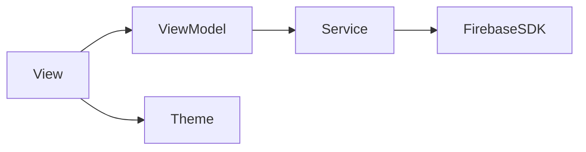
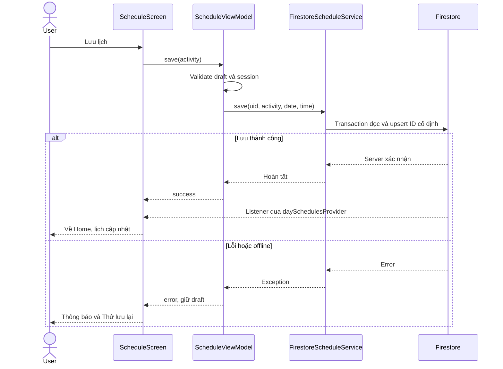

# Lab 3 — Kiến trúc Power9 Office Routine

Khởi tạo 31/10/2026: Flutter 3.47.3, Dart 3.13.3, Riverpod 3.4.3; Android package `vn.power9.power9_office_routine`. Firebase project mới đã cấu hình, có Auth và Firestore.

## Tiến độ tích hợp

Project `power9-office-se180724`; app ID `1:613232000873:android:f65f6f74ecdc93e31407f8`. FlutterFire CLI 1.4.1 đã sinh `lib/firebase_options.dart` và `android/app/google-services.json`. Đã đăng ký SHA-1 debug. Firebase Core 5.1.0, Firebase Auth 7.0.1, Google Sign-In 7.2.0 được pin. Người dùng bật Google provider; config có OAuth đúng package/project. Đăng nhập đã vào Home trên Xperia; cần tiếp tục bằng chứng Users console và các nhánh Auth còn lại.

`FirebaseBootstrap` khởi tạo SDK qua `bootstrapProvider`; app chỉ đọc session sau khi bootstrap hoàn tất. `FirebaseAuthService` là nơi duy nhất gọi Firebase Auth/Google SDK; chuyển User thành AppUser, ánh xạ hủy/lỗi thành AuthFailure. `LoginViewModel` chặn request lặp và quản lý loading/error. `sessionProvider` theo dõi authStateChanges, signed-out chỉ thấy Login; signed-in vào HomeShell. `ProfileViewModel` gọi signOut; state riêng theo vòng đời màn hình. Không dùng local bool để giả session. Home dùng DayClock/currentDayProvider để tự chuyển query khi qua ngày mới.

## Khung ban đầu và hướng mở rộng

- `lib/main.dart`: khởi động và ProviderScope; điểm bootstrap Firebase khi có cấu hình.
- `lib/app.dart`: MaterialApp, locale tiếng Việt, theme, bootstrap gate và auth gate.
- `lib/theme/`: token từ handoff Lab 2.
- `lib/widgets/`: component dùng lại, logo gốc.
- `lib/screens/`: render state và gửi action; không gọi SDK.
- `lib/viewmodels/`: state/nghiệp vụ, inject service qua Riverpod.
- `lib/services/`: biên SDK; FirebaseBootstrap, AuthService và FirebaseAuthService.
- `android/`: build, manifest, icon nền trắng.
- `docs/`: thiết kế, kế hoạch và bằng chứng.
- `lib/models/`: AppUser độc lập SDK; các model nghiệp vụ sẽ thêm khi triển khai.
- `firebase/`, `e2e_test/`: thêm khi triển khai phần tương ứng.

```mermaid
sequenceDiagram
  actor User
  participant View as LoginScreen
  participant VM as LoginViewModel
  participant Service as AuthService
  User->>View: Chọn đăng nhập
  View->>VM: signIn()
  VM->>Service: signInWithGoogle()
  alt Hủy hoặc lỗi đăng nhập
    Service-->>VM: AuthFailure với thông báo
    VM-->>View: loading=false, thông báo lỗi
    View-->>User: Giữ Login và có thể thử lại
  else Xác thực thành công
    Service-->>VM: Hoàn tất signInWithCredential
    Service-->>View: Session stream qua sessionProvider
    View-->>User: Hiển thị Profile qua auth gate
  end
```

| ViewModel | Service | State |
| --- | --- | --- |
| LoginViewModel | AuthService qua provider | idle/loading/error; session qua sessionProvider |
| ProfileViewModel | AuthService qua provider | AsyncValue<void> cho signOut |

Không có nút bỏ qua đăng nhập. Lỗi build Kotlin cross-drive (Pub cache C:, project D:) được xử lý bằng `kotlin.incremental=false` trong `android/gradle.properties`; đổi lại Kotlin có thể compile chậm hơn, không thay đổi hành vi app.

## Bổ sung F01/F03

Authenticated navigator dùng key theo uid. Khi sign-out hoặc đổi user, toàn bộ route riêng tư được hủy, không chỉ thay root phía sau các màn đã push. Sau sign-in, HomeShell thay Profile ở root; Profile mở từ icon tài khoản.

| ViewModel/provider | Service | Trách nhiệm |
| --- | --- | --- |
| activitiesProvider, groupActivitiesProvider, activityByIdProvider | ActivityService → FirestoreActivityService | Danh mục cloud; lọc nhóm/tra cứu activity ở tầng state |
| DiscoverViewModel, discoverResultsProvider, discoverGroupsProvider | activitiesProvider | Query, thời lượng, reset, nhóm kết quả; không đặt nghiệp vụ lọc trong build |
| daySchedulesProvider(dateKey) | ScheduleService → FirestoreScheduleService | Listener theo uid và ngày; xóa state khi session đổi |
| ScheduleViewModel | ScheduleService | Draft riêng từng route, validation, loading/error/retry và chống gửi lặp |

Model Activity/Schedule/AppUser không import Firebase/Flutter. SDK Firestore và chuyển snapshot thành model nằm trong service. Schedule dùng transaction và ID cố định `activityId_dateKey` để retry không nhân đôi; giữ createdAt khi edit. Listener bỏ snapshot còn pending và nhận metadata updates để Home chỉ phản ánh server-confirmed saves. Tìm/filter/group nằm ở ViewModel/provider. Date/time picker và navigation là tương tác View, không ghi SDK từ View.

Cloud Firestore 7.1.0; database Standard ở asia-southeast1, freeTier=true theo response tạo database. Chưa bật billing. Local admin seed script dùng tài khoản Firebase CLI và thư viện firebase-tools 15.33.0 trong memory, không lưu token/khóa service-account. Script không là custom backend của ứng dụng. Catalog là nội dung sản phẩm, không tạo lịch sử cá nhân giả.

## F02 — phiên thư giãn và tiến độ

| Tầng | Thành phần | Trách nhiệm |
| --- | --- | --- |
| Model | Completion, CompletionSource, TodayOverview/TodayItem | Dữ liệu độc lập SDK; hợp nhất schedule/completion, tính done/total và durationLabel |
| Service | SessionClock/MonotonicSessionClock | Stopwatch elapsed time, start/pause/reset; không đếm tick UI làm thời lượng |
| Service | CompletionService/FirestoreCompletionService | Listener theo uid/ngày, transaction create-if-absent và delete chỉ completion |
| ViewModel | SessionViewModel | Idle/running/paused/finished; elapsed cap, save/retry, chặn ghi lặp, giữ thời lượng khi lỗi |
| ViewModel | completionActionProvider | Record/undo theo activity+date; loading/error riêng, không gọi SDK từ widget |
| State providers | dayCompletionsProvider, completionForActivityProvider, todayOverviewProvider | Kết hợp dữ liệu có loading/empty/error, refresh theo session/day |
| View/widgets | RelaxScreen, FoodScreen, ProgressScreen, P9CompletionButton, P9ProgressSummary | Render trạng thái; thao tác xác nhận và điều hướng, không tính thời lượng hay ghi Firebase trực tiếp |

Timer refresh UI mỗi 250 ms nhưng lấy thời lượng từ Stopwatch. Pause dừng clock; resume tiếp tục; background vẫn tính elapsed, khi resumed refresh ngay và cap đúng mục tiêu. Kết thúc sớm không tự ghi đủ 3 phút. Rời tab/profile/back khi có phiên chưa ghi phải chọn Ở lại/Bỏ phiên; Ở lại giữ running/paused, Bỏ phiên reset không gọi record. Ghi nhận thành công mở Progress trên Home để Back về Home theo F02.

Provider timer và completion actions theo dõi UID; generation token ngăn kết quả request cũ cập nhật state của tài khoản mới sau logout. Timer bị hủy khi provider dispose. Process bị hệ điều hành kill thì phiên chưa ghi không được tự phục hồi hoặc tự tạo completion; đây là giới hạn hiện tại, không coi như đã hoàn thành phiên.

Food/check-in không đo thời lượng nên durationSeconds=null. Mỗi activity/ngày có tối đa một completion; trường hợp đã có từ thiết bị khác được giữ nguyên, không ghi đè. Home và Progress dùng cùng TodayOverview, xóa completion không thay schedule.
