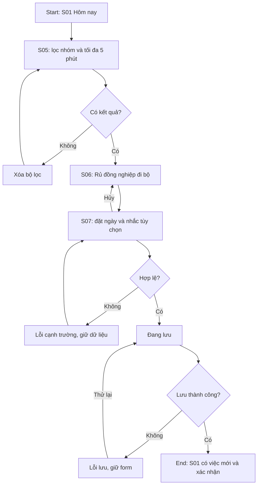
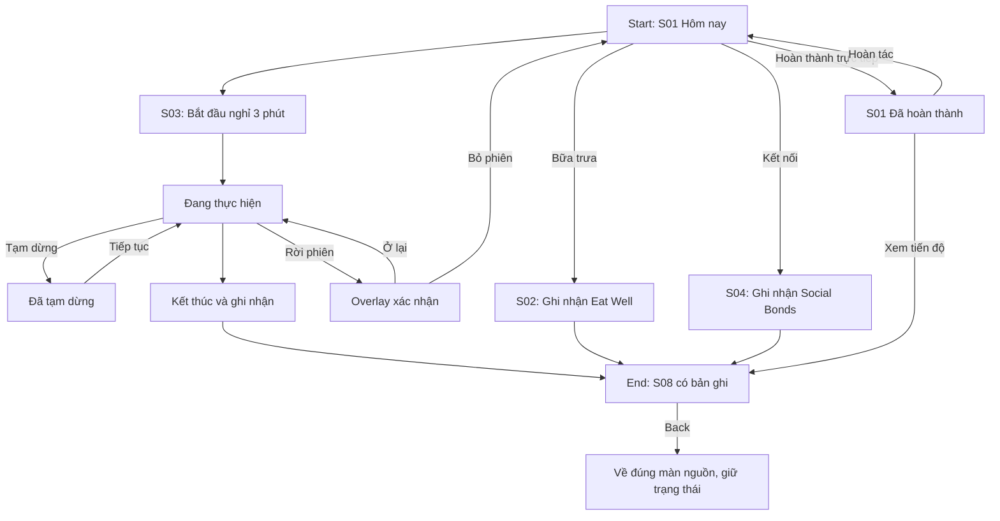
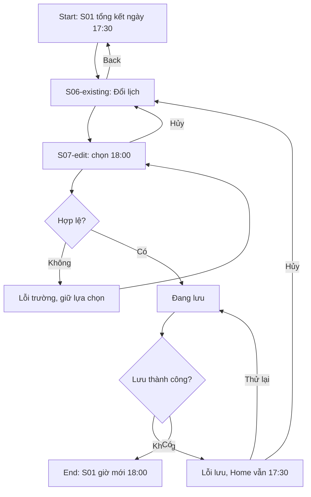

# IA và ba flow — Power9 Office Routine

Ba flow đã nối trong Figma page06; kiểm tra cấu trúc/dữ liệu đã qua, chưa có kiểm thử người dùng thực. Huy 28, Mai 24 và Linh 39 đều là persona chính ngang nhau, hiện là giả định. F01 đại diện Mai, F02 đại diện Huy, F03 đại diện Linh.

## IA
- Bốn tab kế thừa UI hiện có: S01 Hôm nay / S02 Ăn uống / S03 Thư giãn / S04 Kết nối.
- S01 mở S05 Khám phá và S08 Tiến độ. Mọi nhóm trong chín nhóm đến được qua S05.
- S05 → S06 Chi tiết → S07 Lịch → S01 sau lưu; S01 card đã có → S06-existing → S07-edit.
- S02/S03/S04 ghi nhận → S08. Back từ S08 về đúng nguồn; từ S06 về đúng danh sách và giữ lọc.
- Chín nhóm: Move Often, Sit Smart, Eat Well, Sleep Well, Manage Stress, Healthy Space, Social Bonds, Purpose, Work–Life Balance.

## F01 — Tìm và thêm hoạt động
Mai tìm hoạt động phù hợp thời gian rảnh. Start S01; goal thêm một hoạt động ≤5 phút; end S01 có việc mới. Target <60 giây, chưa đo.

## F02 — Thực hiện, ghi nhận và xem lại
Huy nghỉ sau họp. Start S01; goal hoàn thành một phiên; end S08 có bản ghi. Check-in trực tiếp từ Home ≤3 thao tác là mục tiêu riêng, không tính thời gian thực hiện phiên.

Rời từ paused phải phục hồi paused nếu chọn ở lại. Chưa kết thúc không tự ghi nhận. Hoàn tác và xóa có xác nhận phải đồng bộ Home/history.

## F03 — Đổi lịch khi bận
Linh có mốc tổng kết ngày 17:30 trùng cuộc họp; cần chuyển sang 18:00 và kiểm tra giờ yên lặng. Start S01; goal lưu lịch phù hợp và giữ quyền chủ động nhắc ngoài giờ; end Home giờ mới. Mục tiêu đặt lịch/giờ yên lặng <60 giây, chưa đo. Huy cũng có thể dùng cùng form để đổi lịch vận động.

## Mapping
| Flow | Màn chính | Alternate/error |
| --- | --- | --- |
| F01 | S01/S05/S06/S07 | S05 empty, S07 validation/loading/error/retry, hủy |
| F02 | S01/S03/S08 | S02/S04, paused, overlay, check-in/undo, S08 empty |
| F03 | S01/S06/S07 | hủy/Back, validation/loading/error/retry |

Cả tám màn đều có vai trò. S06 là template dùng cho cả chín nhóm; khác dữ liệu không tính thêm màn. Chưa tích hợp lịch công ty. Giờ yên lặng là lựa chọn cá nhân, không khóa việc tạo hoạt động ngoài giờ.
