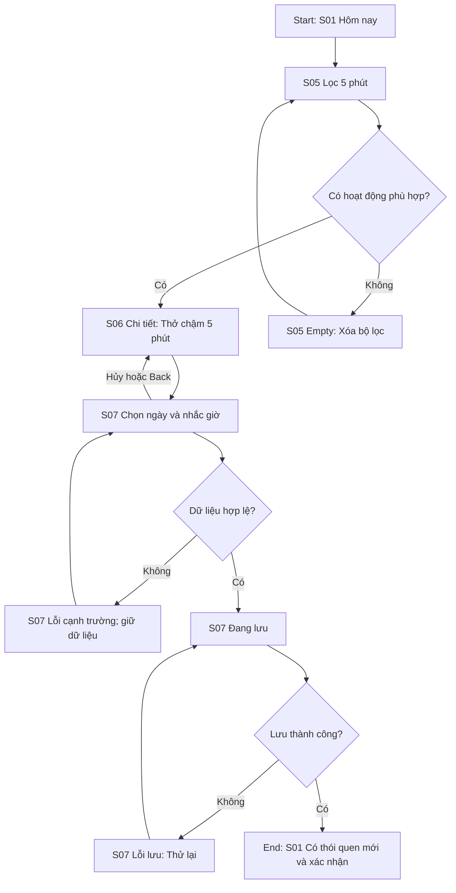
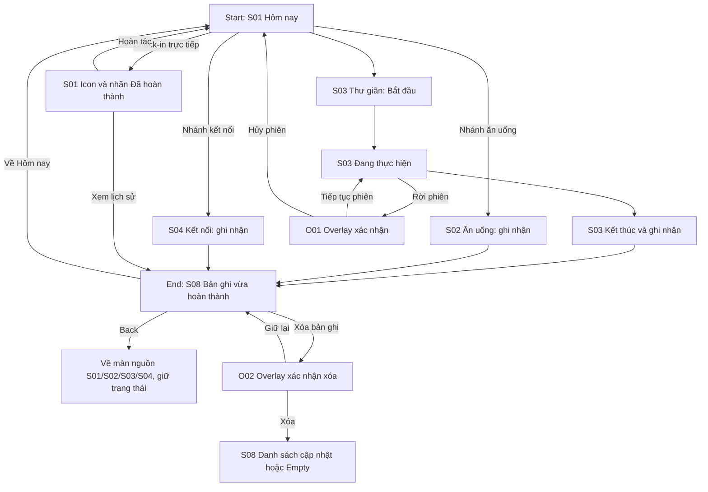
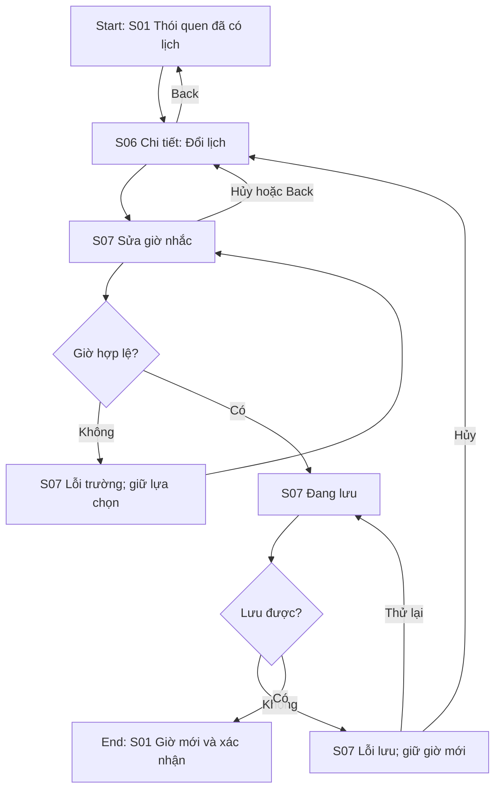

# Kiến trúc thông tin và ba flow Power9

Trạng thái: phân tích và sơ đồ đầu vào cho Stitch; chưa xác nhận prototype đã nối. Persona chính: P03 Linh. Bốn persona là giả định.

## Kiến trúc thông tin

- Cấp cao nhất: S01 Hôm nay, S02 Ăn uống, S03 Thư giãn, S04 Kết nối.
- Màn con từ S01: S05 Khám phá, S06 Chi tiết thói quen đã thêm, S08 Lịch sử.
- S05 → S06 → S07 Lịch thói quen → S01 khi lưu.
- S02/S03/S04 ghi nhận → S08; S08 Back về màn nguồn.
- S06/S07 Back/hủy về context trước; không lưu ngầm.
- Entry Khám phá luôn đến S05; không biến S05 thành tab thứ năm.
- Danh sách 8 màn và state: design/screen-spec.md. Dialog và state không tính thêm màn.

## F01 — Tìm và thêm hoạt động ngắn

Start: S01. Goal: Linh tìm hoạt động ≤5 phút và thêm vào hôm nay. End: S01 hiển thị thói quen mới, xác nhận lưu. UX target <60 giây, chưa kiểm thử.

Happy path: A → B → C → D → F → G → I → J → L. Alternate: đổi bộ lọc hoặc hủy thêm. Error/recovery: validation, lỗi lưu, retry giữ dữ liệu. Loading là state S07, không phải màn thứ chín.

## F02 — Hoàn thành và xem lại

Start: S01. Goal: ghi nhận một hoạt động và xem kết quả. End: S08 có bản ghi; quay Home bằng điều hướng phù hợp. Hoàn tác phục hồi bấm nhầm. Mục tiêu Minh ≤3 thao tác từ Home và Hùng <30 giây không hướng dẫn được kiểm thử riêng, chưa đạt chỉ nhờ sơ đồ.

Ký hiệu E là đích chung S08; implementation phải nhớ nguồn S02/S03/S04/S01 để Back đúng. Trong happy path, Back về S03 ở trạng thái đã kết thúc, không tự khởi động lại timer. Nhánh phụ trở về đúng màn nguồn tương ứng. Hoàn tác check-in phải đồng bộ cả Home và lịch sử trong các frame prototype mô phỏng.

## F03 — Đổi lịch khi bận

Start: S01 có thói quen đã thêm. Goal: Huy chuyển giờ nhắc. End: S01 hiển thị giờ mới; target <30 giây, chưa kiểm thử.

Hủy ở bất kỳ bước sửa chưa lưu giữ lịch cũ. Lỗi lưu giữ lựa chọn trên form nhưng không làm Home giả như đã lưu thành công.

## Ánh xạ luồng với màn hình

| Luồng | Nhánh thành công chính | Nhánh thay thế / phục hồi |
| --- | --- | --- |
| F01 | S01, S05, S06, S07, S01 | S05 empty/reset, S07 validation/loading/error/retry/cancel |
| F02 | S01, S03, S08 | S02, S04, S01 direct completion/undo, O01, O02, S08 empty |
| F03 | S01, S06, S07, S01 | Cancel/Back, S07 validation/error/retry |

Tất cả tám màn có vai trò trong ít nhất một flow. Khi demo cần chạy nhánh S02/S04 nếu dùng để chứng minh hai màn có tương tác thật, không chỉ vẽ chúng.

## Bằng chứng cần bổ sung

Screenshot ba sơ đồ trên Figma page 01; ba prototype starting point trên page 06; video/ảnh hoặc kiểm tra trực tiếp các nhánh; số đo UX thực tế nếu có. Sơ đồ Markdown không chứng minh prototype đã hoạt động.
